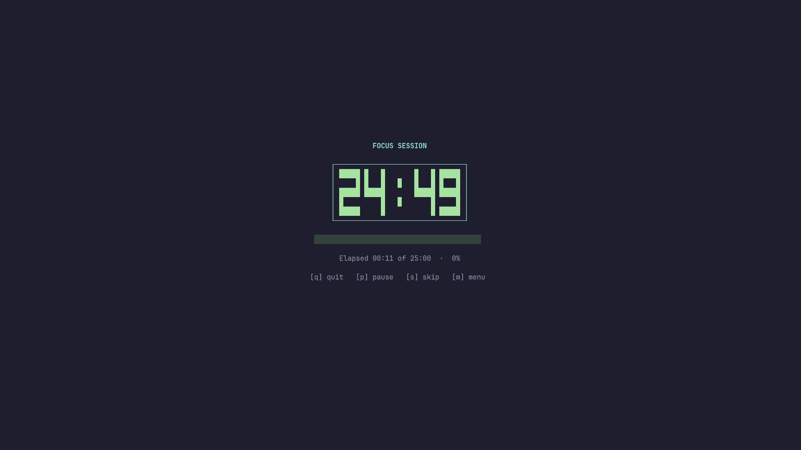

# pomo

A pretty pomodoro timer for your terminal — one Bash file, nothing else
to install.



Big block-digit countdown, progress bar, colors, desktop notifications
and a session log. Run `pomo` to confirm before starting a focus
session, or use `pomo start` to start immediately.

## Install

One command, no root:

```console
mkdir -p ~/.local/bin \
    && curl -fsSL https://raw.githubusercontent.com/Yapidev/pomo/main/pomo \
        -o ~/.local/bin/pomo \
    && chmod +x ~/.local/bin/pomo \
    && echo "Installed $(~/.local/bin/pomo --version)"
```

No `curl`? Swap it for `wget -O ~/.local/bin/pomo <same-url>`.

Open a new terminal (so `~/.local/bin` is on your `PATH`) and run:

```console
pomo
```

- `pomo: command not found`? Add the bin dir:
  `echo 'export PATH="$HOME/.local/bin:$PATH"' >> ~/.bashrc`
- Update later with `pomo update`
- Uninstall with `rm ~/.local/bin/pomo` (your history stays)
- It is one plain script — `less ~/.local/bin/pomo` before your first run
  if you like to know what you execute

<details>
<summary>Debian package</summary>

```console
./build-deb.sh
sudo apt install ./build/pomo_*_all.deb
```

</details>

<details>
<summary>From a clone</summary>

```console
sudo install -Dm755 pomo /usr/local/bin/pomo
```

</details>

## Keys

While the timer runs:

| Key | Action                   |
|-----|--------------------------|
| `p` | Pause / resume           |
| `s` | Skip session             |
| `m` | Menu                     |
| `q` | Quit (asks confirmation) |

The timer screen shows a cycle indicator (`Cycle: ●●○○`) — a long break
comes every 4th completed focus session.

Inside the menu (`m`): navigate with `↑`/`↓` + `Enter`, or direct keys:
`1` focus · `2` short break · `3` long break ·
`h` help · `t` stats · `d` customize durations (`f`/`s`/`l` set focus/short/long,
`r` reset to defaults, `a` save to config, `b` back) · `c` cycle theme ·
`b` back · `q` quit. The currently running session is marked `(active)`.

Between sessions: `Enter` start the next session · `m` menu · `t` stats ·
`d` customize durations · `q` quit.

Only **completed** sessions are logged — skipping or switching writes nothing.

## Commands

| Command         | What it does                                     |
|-----------------|--------------------------------------------------|
| `pomo`          | Confirm, then start a focus session (25 min)     |
| `pomo start`    | Start focus immediately (25 min)                 |
| `pomo -w`       | Short break (5 min)                              |
| `pomo -W`       | Long break (15 min)                              |
| `pomo resume`   | Resume an interrupted session                    |
| `pomo stats`    | Today's summary + 7-day chart                    |
| `pomo status`   | One-line status for status bars                  |
| `pomo config`   | Show config file + durations                     |
| `pomo theme`    | Show / pick a color theme                        |
| `pomo update`   | Self-update from GitHub                          |
| `pomo --help`   | Everything above, in the terminal                |

The cycle is automatic: every 4th completed focus session is followed by
a long break, the others by a short break. You confirm before each next
session starts.

## Themes

Seven looks are built in: `default`, `dracula`, `gruvbox`, `nord`,
`solarized`, `matrix`, `mono`.

```console
pomo theme nord       # switch (saved in ~/.config/pomo/theme)
POMO_THEME=matrix pomo # just for this one run
```

Or press `c` in the menu to flip through them live — each pick is
saved automatically.

## Custom durations

Per run:

```console
POMO_FOCUS_SECONDS=1800 pomo        # 30 min focus
POMO_SHORT_BREAK_SECONDS=600 pomo -w # 10 min short break
POMO_LONG_BREAK_SECONDS=1200 pomo -W # 20 min long break
POMO_ANIMATION=off pomo             # disable the pixel animations
```

Or permanently, in `~/.config/pomo/pomo.conf`:

```console
FOCUS_SECONDS=1800        # 30 min
SHORT_BREAK_SECONDS=600
LONG_BREAK_SECONDS=1200
```

Keys are case-insensitive, `#` starts a comment, unknown keys are ignored.
Precedence: environment variable > `pomo.conf` > default.
`pomo config` shows the file path and the durations currently in effect.

## Status bar

`pomo status` prints one plain line — `focus 12:34`,
`short break 03:21 (paused)`, or `idle` — and exits `0` while a
session is running (`1` otherwise). Drop it straight into a bar:

```console
# tmux
set -g status-right '#(pomo status)'
```

```json
// waybar
"custom/pomo": { "exec": "pomo status --json", "return-type": "json", "interval": 1 }
```

`--json` emits `{"text", "alt", "tooltip", "class", "paused"}` —
`class` is an array with the active mode (`focus`, `short_break`,
`long_break`, `idle`) plus `paused` when paused, so you can style it:

```css
#custom-pomo { color: #a6e3a1; }
#custom-pomo.paused { color: #f9e2af; }
```

The running timer publishes its state in
`${XDG_RUNTIME_DIR:-~/.local/share/pomo}/pomo.state`, so `pomo status`
works from any other terminal.

## Interrupted sessions

If pomo is killed or the terminal closes mid-session, the remaining time
is kept — `pomo resume` continues where it stopped, with the progress
bar still scaled to the full session. Completed sessions are logged with
their full duration, even when finished across multiple sittings.

A session that already ran out of time while pomo was closed is
discarded: `pomo resume` says so and logs nothing.

## Audio

Pomo plays a sound when a session completes. By default, focus uses
`/usr/share/sounds/freedesktop/stereo/complete.oga`; both short and long
breaks use `/usr/share/sounds/freedesktop/stereo/bell.oga`.

Set paths permanently in `~/.config/pomo/pomo.conf`:

```console
SPEAKER_SOUND=/path/to/default.oga
FOCUS_SOUND=/path/to/focus.oga
BREAK_SOUND=/path/to/break.oga
```

`FOCUS_SOUND` may be left unset to use `SPEAKER_SOUND`. For one run, use
`POMO_SPEAKER_SOUND`, `POMO_FOCUS_SOUND`, and `POMO_BREAK_SOUND`.
Pomo tries `paplay`, then `aplay`, then `beep`; if none can play the
sound, it falls back to the terminal bell. To supply a custom playback
command, set `SPEAKER_CMD` in `pomo.conf` or `POMO_SPEAKER_CMD` in the
environment. The command receives the selected sound path as `$1`:

```console
POMO_SPEAKER_CMD='paplay "$1"' pomo
```

## Notifications

When a session completes, pomo sends a desktop notification using
`notify-send`, if it is installed. By default, the notification uses
critical urgency.

To customize the notification command permanently, add `NOTIFY_CMD`
to `~/.config/pomo/pomo.conf`. For example, to use normal urgency:

```console
NOTIFY_CMD=notify-send -u normal -a pomo "$1" "$2"
```

To override the command for a single run, use `POMO_NOTIFY_CMD`:

```console
POMO_NOTIFY_CMD='notify-send -u normal -a pomo "$1" "$2"' pomo
```

The custom command receives the notification title as `$1` and the
message as `$2`. Setting `NOTIFY_CMD` or `POMO_NOTIFY_CMD` replaces
the default desktop notification command. Session audio and the
terminal bell are handled separately.

## Animation

The timer uses a pixel-style animation: digits light up pixel by pixel
at session start, and the colon blinks every second. Set
`POMO_ANIMATION=off` to disable the animations.

## Where is my data?

Completed sessions are appended to
`~/.local/share/pomo/history.log` (`XDG_DATA_HOME` respected) as
`date|type|seconds`, e.g.:

```
2026-10-16|focus|1500
```

Plain text — grep it, back it up, or delete it. That is all pomo stores.

## Development

```console
tests/run_tests.sh    # pure-Bash test suite, no framework needed
```

## License

MIT — see [LICENSE](LICENSE).
